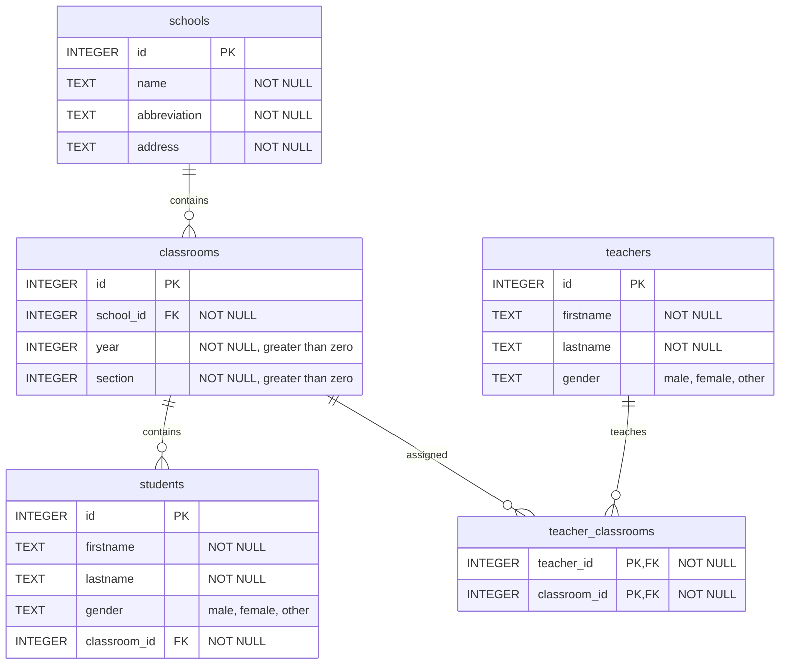

# Database diagram

## ความสัมพันธ์

- โรงเรียนหนึ่งแห่งมีห้องเรียนได้หลายห้อง แต่ละห้องอยู่ในโรงเรียนเดียว
- ห้องเรียนหนึ่งห้องมีนักเรียนได้หลายคน นักเรียนแต่ละคนต้องอยู่ในห้องเดียว
- ครูและห้องเรียนมีความสัมพันธ์แบบ many-to-many ผ่าน teacher_classrooms ครูอาจยังไม่มีห้องสอน และห้องอาจยังไม่มีครูได้
- โรงเรียนของครูดูจากห้องที่สอน ครูจึงสอนข้ามโรงเรียนได้ตามโครงสร้างนี้

## Keys และ constraints

| ตาราง | ข้อกำหนด |
|---|---|
| schools | id เป็น primary key |
| classrooms | id เป็น primary key และ (school_id, year, section) ต้องไม่ซ้ำกันทั้งชุด |
| teachers | id เป็น primary key และ gender รับ male, female, other |
| students | id เป็น primary key และ gender รับ male, female, other |
| teacher_classrooms | (teacher_id, classroom_id) เป็น composite primary key ป้องกันการผูกครูกับห้องเดิมซ้ำ |

ทุก field ที่เป็นข้อมูลใน schema กำหนด NOT NULL ส่วน year และ section มี CHECK ให้มากกว่า 0 การตรวจข้อความว่างอยู่ใน request validation

## การลบข้อมูล

| Foreign key | ON DELETE | ผลเมื่อมีข้อมูลอ้างอิง |
|---|---|---|
| classrooms.school_id → schools.id | RESTRICT | ต้องย้ายหรือลบห้องก่อนลบโรงเรียน |
| students.classroom_id → classrooms.id | RESTRICT | ต้องย้ายหรือลบนักเรียนก่อนลบห้อง |
| teacher_classrooms.classroom_id → classrooms.id | RESTRICT | ต้องเอาครูออกจากห้องก่อนลบห้อง |
| teacher_classrooms.teacher_id → teachers.id | CASCADE | เมื่อลบครูจะลบรายการเชื่อมห้องของครูด้วย |

API ตอบ 409 เมื่อการลบติดข้อจำกัด RESTRICT การลบครูจะลบเฉพาะครูและรายการเชื่อมกับห้อง ส่วนข้อมูลห้องเรียนยังใช้ต่อได้

## Indexes

- students.classroom_id ใช้ค้นหานักเรียนตามห้อง
- teacher_classrooms.classroom_id ใช้ค้นหาครูตามห้อง
- Composite primary key (teacher_id, classroom_id) ใช้ค้นหารายการห้องของครู
- Unique constraint (school_id, year, section) สร้าง index ที่ใช้ค้นหาห้องตาม school_id ได้
