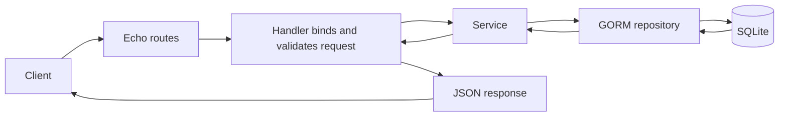
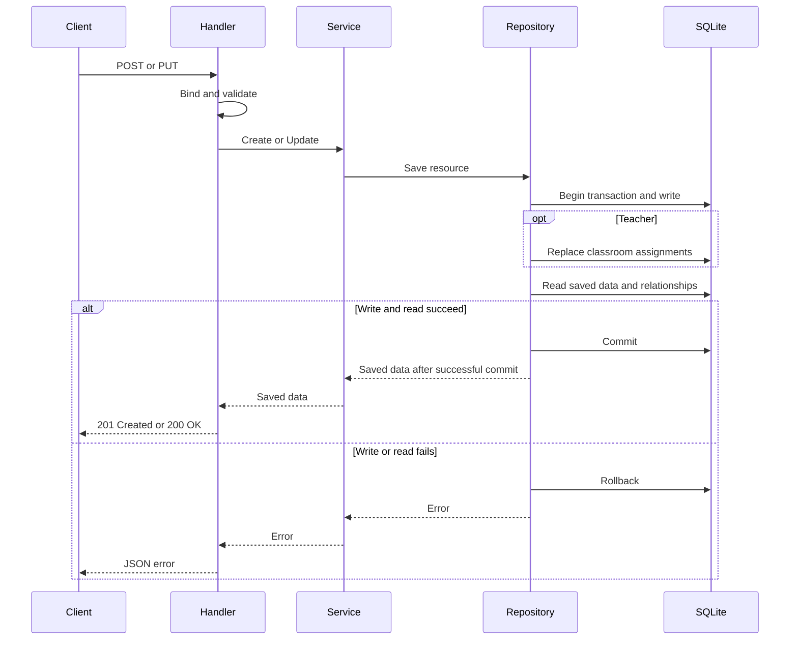

# REST API flow

main.go เปิด SQLite และประกอบ dependencies ก่อน register routes ใน Echo จากนั้น handler อ่าน path และ query parameters, bind JSON และตรวจ validation tags ตามประเภท request แล้วส่ง request context และข้อมูลให้ service ผ่าน interface

Service ทำงานตาม use case และเรียก repository เช่น ประกอบรายละเอียดห้องเรียนจากรายชื่อครูและนักเรียน ส่วน repository ใช้ GORM สำหรับ CRUD, filters และ transactions หากเกิด error ตัวจัดการกลางของ Echo จะแปลงเป็น HTTP status และ error code

## Create และ Update

Repository อ่านข้อมูลที่จะคืนใน transaction เดียวกับการบันทึก ถ้าอ่านกลับล้มเหลว การเปลี่ยนแปลงทั้งหมดจะถูก rollback รวมถึงรายการห้องที่สอนของครู

[ER diagram, keys และ delete constraints](database-diagram.md)
